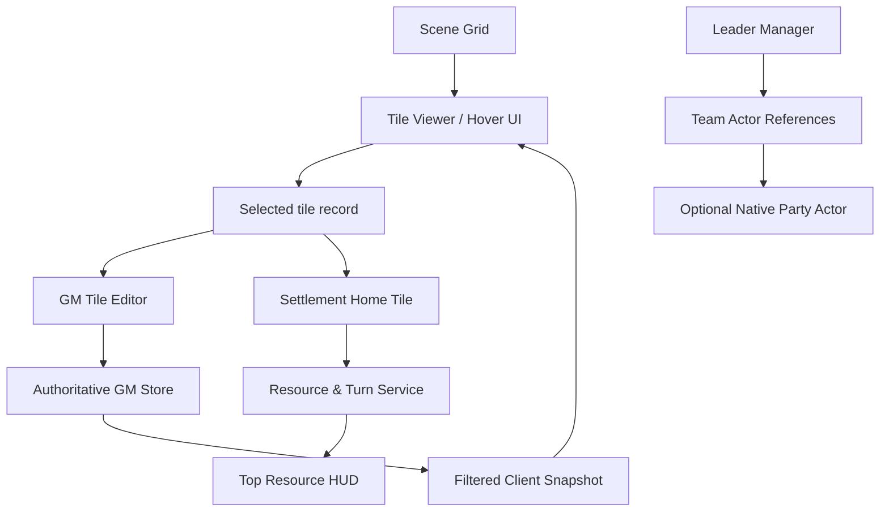
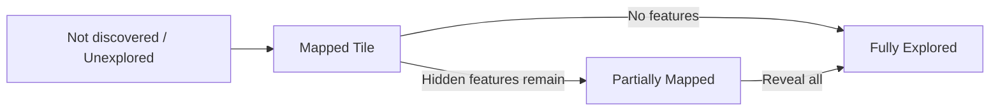

# Settlement Tile Manager — v0.2.0 beta

A **Foundry VTT v14 beta** for Kingmaker-inspired map tile editing, settlement resources, and leader teams. The module is system-agnostic at its core, but its Actor/Party integration uses document types offered by the active game system. It does **not** require the premium Kingmaker adventure.

> **Beta warning:** The module has not been tested in a running Foundry server. Back up your world before upgrading from v0.1.x. Test with a disposable world and report console errors and your Foundry/PF2e versions. The 9 Node domain tests are not Foundry UI tests.

## Install

Place the extracted `settlement-hex-manager/` directory in your Foundry user-data `Data/modules/` directory; restart Foundry, then enable **Settlement Tile Manager** in the world.

When the GitHub release has actually been published, use this manifest URL in Foundry's Install Module field:

`https://raw.githubusercontent.com/powercore2000/settlement-hex-manager/main/module.json`

A release ZIP and matching manifest download URL must both exist for UI installation to work. Merely placing source files in GitHub does not publish an installable release.

## Key controls

**Top HUD:** three buttons: **Settlement Manager**, **Tile Viewer**, and **Leader Manager**. The HUD also shows current settlement resources.

**Tile Viewer:** Hover a gridded scene tile for a border highlight and a dark semi-transparent summary popup. Tiles without saved data highlight red and show no popup. Left-click the gridded canvas to select the tile and open its detailed viewer. GM can open **Edit Tile Data** for that tile; new tiles open the editor directly. Use **Enable normal click tile viewer** in module settings to disable interception when needed.

**Editor:** Name, thumbnail URL/image path, region, zone, terrain, travel, security, discovered, status (Unexplored/Mapped), cleared, claimed, owner, commodity, camp, notes, and GM notes. Feature rows select existing **world Items** bearing the `landmark-feature` flag/tag; each row retains its own Revealed checkbox.

**Landmark Feature tagging:** In a Foundry macro or dev console, run `await game.items.get('ITEM_ID').setFlag('settlement-hex-manager','landmark-feature',true)` for an existing world Item. Item images, names, and descriptions are pulled from the item. Compendium-only items should first be imported to world Items. Existing unlinked feature data from v0.1 may remain in storage but cannot be reselected until converted into tagged Items.

**Explored label** is derived, not manually edited:
- **Unexplored** when undiscovered or status is Unexplored.
- **Partially Mapped** when mapped and at least one feature exists but is hidden.
- **Fully Explored** when mapped and zero features exist or all features are revealed.

**Settlement Manager:** Create a settlement with the selected tile as its required home. The module creates an Actor of type `vehicle` when the game system supports it, or falls back to `npc` or the first available native actor type. A settlement summary is added to the native Actor sheet. The authoritative settlement data is managed in the module store, not by overwriting PF2e HP fields. Security starts at 20, Morale at 0, population at 0, and resources at 0. Current Pop and Max Pop are separate module fields. Settlement resource types are Rations, Materials, Resources, Supplies, and Uniques. Every advance turn consumes Rations up to the supported population; it never drives inventory negative.

**Leader Manager:** GM may create and delete team records. A Party Actor is also created when the active system supports the `party` actor type. Team membership is a list of Actor references, and no Actor can belong to more than one team. A team can designate one leader and select an activity. The button **Open Party Sheet** opens the system-native Party sheet where supported. Deleting a team deletes only the team record; Actors and Party Actor are retained. Team members are not registered as actual PF2e party members through system internals in this beta; the record is a non-destructive reference collection.

**Draggable dialogs:** Drag a module window using its dark title bar. Only the module's own dialog is draggable in this beta; it does not alter unrelated Foundry dialogs.

## Changes from v0.1.0

| Feedback | v0.2.0 implementation |
|---|---|
| `graphics.poly is not a function` | Canvas polygons drawn with `moveTo/lineTo/closePath/fill/stroke` rather than `graphics.poly` |
| Movable modal | Pointer-drag title bar; modal position preserved during rerender |
| Three menu buttons | Settlement Manager / Tile Viewer / Leader Manager |
| Shift-click removal | Standard hover and left click on gridded canvas; works with square or hex grids subject to Foundry canvas behavior |
| Hover feedback | Configurable hex RGB highlight, missing-data red, dark hover information tooltip |
| Tile thumbnail | Path/URL stored per tile and shown in viewer and hover tooltip |
| Explored labels | Unexplored / Partially Mapped / Fully Explored derived from status and feature reveal state |
| Removed Reconnoitered | Old `reconnoitered` data maps to `mapped` in validation; editor offers only Unexplored / Mapped |
| Landmark Features | Tagged world Item selection with per-tile reveal flag; feature summary shows item artwork and description |
| Settlement sheet | Vehicle-type Actor when supported, linked to module settlement state by actor ID; summary on Actor sheet |
| New economy | Rations / Materials / Resources / Supplies / Uniques and population upkeep |
| Leader teams | Team reference collections, leader selection, activities, unique membership, optional Party Actor |

## System architecture

## Implementation boundaries and known limitations

1. **Actor types:** A module cannot register a universal new game-system Actor type named `settlement` without system-specific schema support. This beta creates an Actor using existing types and adds a settlement summary. The native vehicle sheet is **not copied**, and its native HP tooltips are **not renamed** to Population. This would require a PF2e-specific custom sheet integration.
2. **Party membership:** Team reference collections avoid mutating character sheet membership. An optional Party Actor may be created, but adding characters to its native PF2e party membership is not yet integrated.
3. **Movement and tokens:** Native Actor tokens may be placed through Foundry. Automatic synchronization of tile home tokens and one token for each team is not yet implemented.
4. **Item catalog:** The dynamic selector currently indexes tagged *world Items*. Compendium selection is not yet supported.
5. **Hover and click interception:** The browser canvas API is version-sensitive; test in a v14 world. Disable normal click selection in settings if it conflicts with another canvas tool.
6. **Persistence:** Private world data lives in a GM-only JournalEntryPage. Client snapshots filter undiscovered tiles and hidden features. A GM must be connected to accept edits.
7. **Migration:** Old resource balances are not automatically converted into the new resource taxonomy. Export or record previous resource totals before upgrading.
8. **Data consistency:** Actor-linked settlement data is authoritative in module state. The small summary added to the Actor sheet is read-only; editing native HP does not change Settlement Population.
9. **No live Foundry tests:** Domain tests pass in Node, but system integrations, UI rendering, and permission behaviors must be tested manually on your own Foundry installation.

## Local tests

`node --test tests/core.test.mjs`

## Licensing

MIT for this original beta implementation. No proprietary Kingmaker assets or module code included.
