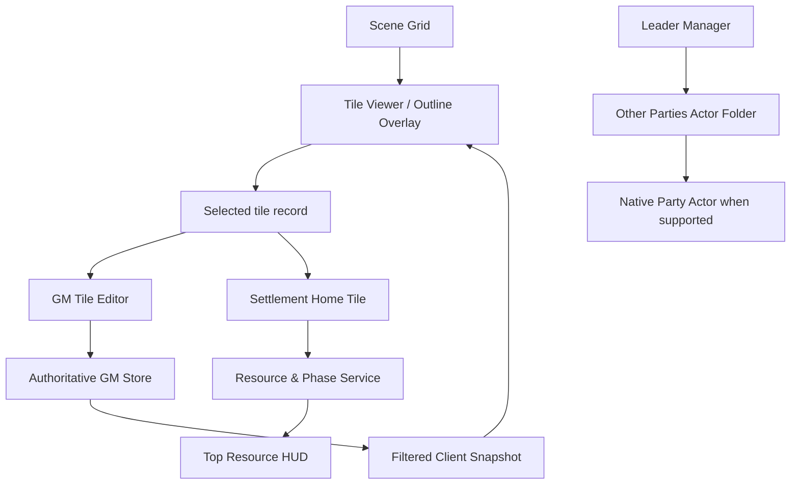
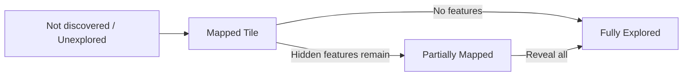

# Settlement Tile Manager — v0.2.2.6 beta

A **Foundry VTT v14 beta** for Kingmaker-inspired map tile editing, settlement resources, and leader teams. The module is system-agnostic at its core, but its Actor/Party integration uses document types offered by the active game system. It does **not** require the premium Kingmaker adventure.

> **Beta warning:** The module has not been tested in a running Foundry server. Back up your world before upgrading from v0.1.x. Test with a disposable world and report console errors and your Foundry/PF2e versions. The Node domain tests are not Foundry UI tests.

## Install

Place the extracted `settlement-hex-manager/` directory in your Foundry user-data `Data/modules/` directory; restart Foundry, then enable **Settlement Tile Manager** in the world.

When the GitHub release has actually been published, use this manifest URL in Foundry's Install Module field:

`https://github.com/powercore2000/settlement-hex-manager/releases/download/v0.2.2.6/module.json`

The `v0.2.2.6` release contains both `module.json` and `settlement-hex-manager-v0.2.2.6.zip` as separate release assets. The ZIP contains `module.json` at its root.

## Key controls

**Top HUD:** the v0.1 castle-header resource bar, with the settlement name, current settlement phase, collapsible resource values, and the original **Resources** and **Activities** actions. Settlement Manager, Tile Viewer, and Leader Manager remain available from the token scene controls and are not duplicated in the bar.

**Tile Viewer:** Toggle **Tile Viewer** in the token scene controls to enable tile interaction. While enabled, every hovered tile receives a green outline whether or not it has saved data. Discovered but unclaimed tiles retain a blue outline, and claimed tiles retain a gold outline. Blue and gold are mutually exclusive; the green hover overlay can appear with either. No popup or information card is created on hover, and no tile effects are rendered while Tile Viewer is disabled. Left-click a tile to open its detailed viewer; GMs can edit existing tile data or create data for an empty tile. Use **Enable normal click tile viewer** in module settings to disable click interception when needed.

**Editor:** Name, tile image selected through Foundry's file browser, region, zone, terrain, travel, security, discovered, status (Unexplored/Mapped), cleared, claimed, owner, commodity, camp, Player Notes, and GM Notes. Player Notes and GM Notes use normal text areas. Landmark descriptions retain Foundry's native rich-text editor and formatting toolbar. Landmark rows store a name, file-browser image, description, and Visible to Players checkbox directly in tile data.

**Explored label** is derived, not manually edited:
- **Unexplored** when undiscovered or status is Unexplored.
- **Partially Mapped** when mapped and at least one feature exists but is hidden.
- **Fully Explored** when mapped and zero features exist or all features are revealed.

**Settlement Manager:** Create a settlement with the selected tile as its required home. Foundry v14 registers the module-owned **Settlement** Actor type and new settlements use it. A settlement summary is added to its sheet. The visible workflow cycles through **Upkeep → Assignment → Activity Resolution → Week End**. Completing Week End returns to Upkeep and performs the existing weekly resource/activity resolution. The internal week number remains only for calculations and ledgers. Security starts at 20, Morale at 0, population at 0, and resources at 0.

**Leader Manager:** Creating a team creates an Actor entry in an **Other Parties** Actor folder, creating that folder when necessary. Party Actor type is preferred when supported. Membership is managed through the Actor/Party sheet rather than a duplicate Members field in Leader Manager. The manager retains activity selection, Open Party Sheet, and non-destructive team-record deletion.

**Draggable dialogs:** Drag a module window using its dark title bar. Only the module's own dialog is draggable in this beta; it does not alter unrelated Foundry dialogs.

## v0.2.2.6 changes

- Publishes sanitized player tile records into module-owned Scene flags so players can read them directly with the scene, independent of the private GM database.
- Player Scene flags contain no GM Notes or hidden landmarks; the authoritative full record remains private.
- Player Tile Viewer controls fall back to an available scene-control group when token controls are unavailable.
- Player tile clicks no longer require the canvas itself to be the exact pointer event target.
- Restores ordinary text areas for Player Notes and GM Notes and removes Player Camping Notes.

## v0.2.2.5 changes

- Players receive Tile Viewer hover and persistent outlines from their filtered tile snapshot.
- Clicking a discovered tile opens the player-safe Tile Viewer without GM Notes, hidden landmarks, Edit Tile Data, or reveal controls.
- Landmark features are standalone name, file-browser image, rich-text description, and player-visibility fields.
- Player Notes, Player Camping Notes, GM Notes, and landmark descriptions use Foundry v14's native ProseMirror editor toolbar.
- Replaces the visible turn counter with Upkeep, Assignment, Activity Resolution, and Week End phases; GMs advance them in order.
- New teams create Actor entries under an Other Parties folder, and Leader Manager no longer duplicates the Members selector.

## v0.2.2.4 changes

- Removes the on-hover popup and all of its DOM, positioning, visibility, and sidebar-boundary logic.
- Hovering any tile in Tile Viewer mode draws a green outline regardless of saved data.
- Discovered, unclaimed tiles have a permanent blue outline; claimed tiles have a permanent gold outline.
- Blue and gold are mutually exclusive, while the green hover outline can layer with either permanent state.
- Tile Manager uses a fixed-height window with a non-scrolling header and an independently scrolling content body.

## v0.2.2.3 changes

- Hover information is removed from the document whenever its visibility conditions fail, preventing invisible popups from affecting Foundry's UI.
- Valid hover information is centered using fixed viewport pixel coordinates without sidebar or edge-boundary calculations.
- Tile Manager can permanently delete the selected tile's module-owned data after confirmation.
- Module settings include a confirmed GM-only action to delete every tile record owned by this module without touching Actors, Items, scenes, or other modules.
- Optional debug console logging covers hover conditions, popup lifecycle, tile clicks, modal activity, canvas binding, and data actions.

## v0.2.2.2 changes

- Tile Viewer and Tile Manager now dock immediately left of Foundry's right-side toolbar and chat/sidebar area.
- Tile-mode activation accepts both Foundry scene-control callback forms, so hover information appears without requiring a click.
- Discovered tiles retain a thin passive gold rim only in Tile Viewer mode, while the currently hovered tile uses the configured hover color.
- The Tile Viewer and Tile Manager title bar remains fixed while the content body scrolls.
- Landmark Feature is explicitly registered and labeled in Foundry's standard Create Item type menu.

## v0.2.2.1 changes

- Tile highlighting and tile hover interaction now run only while the Tile Viewer scene-control toggle is active.
- Explored tiles use a thin gold outline instead of always-visible blue or green outlines.
- Grid outlines use Foundry's absolute grid vertices and client-to-canvas coordinate conversion, correcting zoom, display scaling, and hex-origin offsets.
- The hover information card is pointer-anchored, viewport-clamped, and uses a compact Kingmaker-inspired layout with strictly bounded artwork.

## v2.1.2 changes

- Restores the resource bar layout and interaction design shipped in v0.1.
- Keeps the original Resources and Activities actions in the resource bar.
- Removes Settlement Manager, Tile Viewer, and Leader Manager buttons from the resource bar; those managers remain available from scene controls.

## v0.2.1.1 fixes

- Reuses one canvas graphics layer during hover so Foundry's surrounding UI does not flicker or shift.
- Supports both current and legacy PIXI Graphics drawing APIs; major actions no longer fail when `Graphics.fill` is unavailable.
- Normalizes Foundry document-type collections before membership checks, fixing team creation on systems that expose a keyed object rather than an array.
- Resets only this module's unreadable private database page; Actors, Items, system documents, and other modules' data are never deleted or overwritten.
- Restores a compact resource/turn HUD without the three manager buttons while preserving manager access in scene controls.
- Registers module-owned **Settlement** Actor and **Landmark Feature** Item subtypes.
- Uses Foundry's file browser for tile images and previews the selected image.

## Changes from v0.1.0

| Feedback | v0.2.0 implementation |
|---|---|
| `graphics.poly is not a function` | Canvas polygons drawn with `moveTo/lineTo/closePath/fill/stroke` rather than `graphics.poly` |
| Movable modal | Pointer-drag title bar; modal position preserved during rerender |
| Three menu buttons | Settlement Manager / Tile Viewer / Leader Manager |
| Shift-click removal | Standard hover and left click on gridded canvas; works with square or hex grids subject to Foundry canvas behavior |
| Hover feedback | Configurable hex RGB highlight, missing-data red, dark hover information tooltip |
| Tile thumbnail | Path/URL stored per tile and shown in viewer and hover tooltip |
| Explored labels | Unexplored / Partially Mapped / Fully Explored derived from status and feature reveal state |
| Removed Reconnoitered | Old `reconnoitered` data maps to `mapped` in validation; editor offers only Unexplored / Mapped |
| Landmark Features | Tagged world Item selection with per-tile reveal flag; feature summary shows item artwork and description |
| Settlement sheet | Vehicle-type Actor when supported, linked to module settlement state by actor ID; summary on Actor sheet |
| New economy | Rations / Materials / Resources / Supplies / Uniques and population upkeep |
| Leader teams | Team reference collections, leader selection, activities, unique membership, optional Party Actor |

## System architecture

## Implementation boundaries and known limitations

1. **Actor types:** Foundry v14 namespaces module-defined subtypes, so the visible **Settlement** type is stored as `settlement-hex-manager.settlement`. The module does not modify PF2e's own Actor schemas or native HP fields.
2. **Party membership:** Leader Manager creates an Actor in the Other Parties folder and delegates membership to the system-native Actor/Party sheet.
3. **Movement and tokens:** Native Actor tokens may be placed through Foundry. Automatic synchronization of tile home tokens and one token for each team is not yet implemented.
4. **Landmark data:** Tile landmarks are stored directly in module tile data. Existing legacy Item UUID references are ignored after migration unless their copied name, image, or description is already present.
5. **Hover and click interception:** The browser canvas API is version-sensitive; test in a v14 world. Disable normal click selection in settings if it conflicts with another canvas tool.
6. **Persistence:** Private world data lives in a GM-only JournalEntryPage. Client snapshots filter undiscovered tiles and hidden features. A GM must be connected to accept edits.
7. **Migration:** Old resource balances are not automatically converted into the new resource taxonomy. Export or record previous resource totals before upgrading.
8. **Data consistency:** Actor-linked settlement data is authoritative in module state. The small summary added to the Actor sheet is read-only; editing native HP does not change Settlement Population.
9. **No live Foundry tests:** Domain tests pass in Node, but system integrations, UI rendering, and permission behaviors must be tested manually on your own Foundry installation.

## Local tests

`node --test tests/core.test.mjs`

## Licensing

MIT for this original beta implementation. No proprietary Kingmaker assets or module code included.

